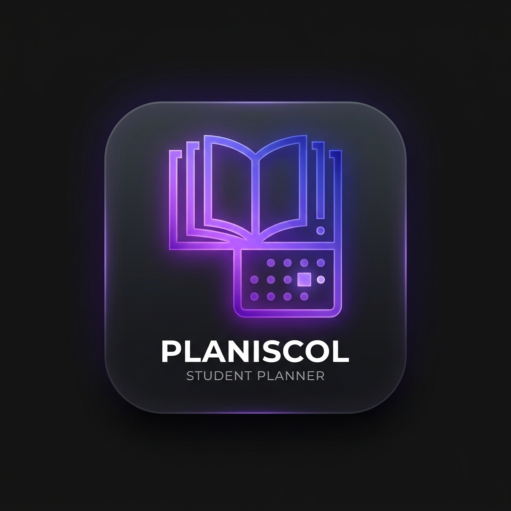

# 🎓 Planiscol — L'Agenda Desktop 100% Dédié à la Vie Scolaire

<p align="center">
  
</p>

<p align="center">
  <strong>Planiscol</strong> est une application desktop moderne, rapide et 100 % locale pour élèves et étudiants (Collège, Lycée, Études Supérieures / Université).<br />
  Elle combine un gestionnaire de tâches intelligent, un agenda synchronisé type Google Agenda, la gestion des matières et des coefficients, le suivi des moyennes, un minuteur Pomodoro et la liaison directe avec les fichiers locaux de cours <strong>sans jamais copier le moindre octet</strong>.
</p>

---

## 🌟 Fonctionnalités Principales

### 1. Gestion des Tâches & Devoirs (Formulaire Unifié)
- **Formulaire unifié de création et d'édition** : Ajoutez dès la création vos sous-tâches et associez vos documents de cours locaux sans délai, dans une même modale intuitive.
- **Attributs complets** : Titre, notes riches (consignes/énoncés), matière, priorité sur 3 niveaux (🔴 Haute, 🟠 Moyenne, 🟢 Basse), type (devoir, contrôle, projet, exposé, révision, lecture), échéance avec heure, durée estimée, statut (à faire, en cours, terminé), étiquettes (#tags).
- **Sous-tâches avec réordonnancement** : Checklist d'étapes (déplaçables haut/bas, renommables, supprimables) avec calcul automatique du pourcentage d'avancement.
- **Planificateur de révisions espacées** : Génération en un clic des sessions de révision suggérées avant un contrôle (J-14, J-7, J-3, J-1).

### 2. Triple Affichage 100% Synchronisé (To-Do / Kanban / Agenda)
- **Vue To-Do List** : Découpage automatique en sections intelligentes (*En retard*, *Aujourd'hui*, *Cette semaine*, *Plus tard*, *Terminées*), filtres combinables (matières, priorités, statuts), recherche instantanée et bouton « Se concentrer ».
- **Vue Tableau Kanban** :
  - **Colonnes & Glisser-déposer** : Colonnes par statut (*À faire*, *En cours*, *Terminé*), réordonnancement fluide et déplacement accessible avec `@dnd-kit` et `Framer Motion`.
  - **Cartes riches** : Pastille/bande matière, badge de priorité accessible (🔴 / 🟠 / 🟢 avec texte explicite), échéance lisible (« En retard », « Demain », « Ven. 18h »), jauge de progression des sous-tâches, compteur de documents liés et alerte de lien cassé, tags, bouton Pomodoro rapide.
  - **Création rapide intégrée** : Bouton « + Ajouter » au pied de chaque colonne pour saisir le titre directement au clavier avec le statut pré-appliqué.
  - **Couloirs horizontaux (Swimlanes)** : Regroupement optionnel par Matière ou par Priorité.
  - **Colonnes personnalisables** : Renommer, ajouter, colorer, réordonner ou supprimer des colonnes supplémentaires rattachées aux 3 statuts fondamentaux.
  - **Historique Annuler / Rétablir** : Raccourcis `Ctrl+Z` / `Ctrl+Y` pour annuler ou rétablir les déplacements de cartes.
- **Vue Agenda type Google Agenda** : Vues Jour, Semaine, Mois, Planning ; déplacement par drag & drop, redimensionnement de la durée, indicateur visuel de l'heure en cours (*maintenant*), et intégration des créneaux de cours en filigrane d'arrière-plan.
- *Toute modification dans une vue est instantanément répercutée dans les autres sans aucune duplication de données.*

### 3. Fichiers & Documents Liés (Règle Absolue : Zéro Copie)
- Liaison directe vers des documents de cours (PDF, Word, Diaporama, images) ou dossiers de révision.
- **Zéro duplication** : L'application n'enregistre que le chemin d'accès absolu. Aucun octet n'est copié ou déplacé.
- **Actions directes** : Ouverture instantanée avec le logiciel système par défaut (`shell.openPath`) et bouton d'affichage dans l'explorateur Windows (`shell.showItemInFolder`).
- **Détection des liens cassés** : Si un fichier est déplacé ou supprimé, un badge d'avertissement s'affiche avec un outil de relocalisation assistée.

### 4. Suivi des Notes & Coefficients
- Enregistrement des notes par matière avec intitulé, coefficient et période (trimestres/semestres).
- Calcul automatique en temps réel de la moyenne par matière et de la **moyenne générale pondérée**.

### 5. Mode Plein Écran Immersif Pomodoro (Focus Mode)
- **Minuteur immersif haute précision** : Minuteur circulaire SVG grand format animé par `Framer Motion`. Calcul temporel basé sur l'horloge absolue du système (`Date.now()`), garantissant l'exactitude même en cas de mise en veille ou d'arrière-plan.
- **Cycles & Transitions de phases** : Travail (25m), Pause courte (5m) et Pause longue (15m) après 4 cycles, entièrement configurables.
- **Ambiance sonore douce** : Carillon harmonique synthétisé via Web Audio API (aucun fichier externe requis), débrayable d'un clic avec le mode silencieux.
- **Panneau latéral 4-en-1** :
  - *Tâche* : rappel complet de l'énoncé et de la matière.
  - *Sous-tâches* : cochage en direct et ajout de sous-tâches au vol.
  - *Documents* : consultation et ouverture directe des fichiers de travail.
  - *Notes de session* : prise de notes avec sauvegarde automatique continue et dialogue de fin de session (fusionner dans la tâche, garder en brouillon ou ignorer).
- **Traçabilité du travail** : Cumul automatique du temps effectif (`actualDuration`) et du nombre de sessions terminées (`focusSessionsCount`) sur chaque tâche.

### 6. Ajout Rapide en Langage Naturel & Palette de Commandes
- **Ajout rapide (`Ctrl+Space` ou `Ctrl+N`)** : Tapez naturellement :
  > `Maths exo p.45 vendredi 18h priorité haute #dm`
  Planiscol extrait automatiquement la matière, la consigne, la priorité, l'échéance et les tags !
- **Palette de commandes (`Ctrl+K`)** : Accès rapide à toutes les vues, recherche de devoirs, changement de thème et sauvegarde instantanée.

### 7. Sécurité, Confidentialité & Mises à Jour Robustes
- **Zéro serveur, zéro compte, zéro télémétrie** : 100% des données restent sur votre ordinateur (`app.getPath('userData')`).
- **Sauvegarde atomique & sécurisée** : Écriture atomique avec protection contre les coupures de courant et sauvegardes rotatives dans `userData/backups/`.
- **Mises à jour transparentes & fiables** : Recherche automatique au démarrage et toutes les 4h, journal persistant dans `planiscol-updater.log` avec bouton d'ouverture directe, bannière de notification avec notes de version, et script de validation `npm run test:updater`.

---

## 🛠️ Stack Technique

- **Runtime** : Electron LTS (`contextIsolation: true`, `nodeIntegration: false`, IPC typé et sécurisé)
- **Frontend** : React 18 + TypeScript (strict mode) + Vite (`electron-vite`)
- **Design & UI** : TailwindCSS, Framer Motion, Lucide-React, Canvas-Confetti
- **État Global** : Zustand
- **Agenda** : FullCalendar (Core, DayGrid, TimeGrid, List, Interaction)
- **Persistance** : Moteur de base de données transactionnel local avec migrations de schéma versionnées
- **Packaging** : `electron-builder` (Installeur Windows NSIS `.exe`)
- **Auto-Update** : `electron-updater` connecté à GitHub Releases (`AgentViande/Planiscol-`)
- **Tests** : Vitest

---

## 🚀 Installation & Développement Local

### Prérequis
- Node.js version 20 ou supérieure
- Git

### Cloner et installer
```bash
git clone https://github.com/AgentViande/Planiscol-.git
cd Planiscol-
npm install
```

### Lancer en mode développement (avec HMR instantané)
```bash
npm run dev
```

### Exécuter les tests unitaires
```bash
npm run test
```

### Compiler pour la production
```bash
npm run build
```

### Générer l'installeur Windows (.exe NSIS)
```bash
npm run build:win
```
L'installeur généré se trouvera dans le dossier `dist/` : `Planiscol-Setup-1.0.0.exe`.

---

## 📦 Publication Automatique & Workflow GitHub

### Dans Antigravity
Pour publier une mise à jour, il vous suffit de taper dans le chat Antigravity :
```
/publier
```
Le workflow automatisé (`.agent/workflows/publier.md`) va :
1. Vérifier le statut de votre dépôt Git et commiter les modifications en cours.
2. Lancer la suite complète de tests unitaires et le build de production.
3. Calculer la version SemVer (patch, minor ou major).
4. Mettre à jour `package.json` et compléter `CHANGELOG.md`.
5. Créer le commit de release `chore(release): vX.Y.Z` et le tag Git `vX.Y.Z`.
6. Pousser vers GitHub (`git push origin main --tags`), ce qui déclenche le workflow GitHub Actions de compilation et de publication de la Release.

### Hors Antigravity (Ligne de commande)
Vous pouvez également lancer la release manuellement :
```bash
npm run release:patch   # Pour une correction (ex: 1.0.0 -> 1.0.1)
npm run release:minor   # Pour une nouvelle fonctionnalité (ex: 1.0.0 -> 1.1.0)
npm run release:major   # Pour une mise à jour majeure (ex: 1.0.0 -> 2.0.0)
```

---

## ⚙️ Configuration Unique sur GitHub

Pour que le système de release et les mises à jour automatiques via `electron-updater` fonctionnent sans aucune configuration supplémentaire :
1. **Dépôt public** : Assurez-vous que le dépôt GitHub `AgentViande/Planiscol-` est **Public** (afin qu'`electron-updater` puisse télécharger les releases sans token d'authentification).
2. **Permissions GitHub Actions** : Dans les paramètres de votre dépôt GitHub (`Settings` > `Actions` > `General` > `Workflow permissions`), activez **"Read and write permissions"** afin que le workflow `.github/workflows/release.yml` puisse publier automatiquement les fichiers `.exe` et `latest.yml`.
3. **Authentification Git locale** : Assurez-vous que votre invite de commande locale est connectée à votre compte GitHub (via SSH ou GitHub CLI `gh auth login`).
